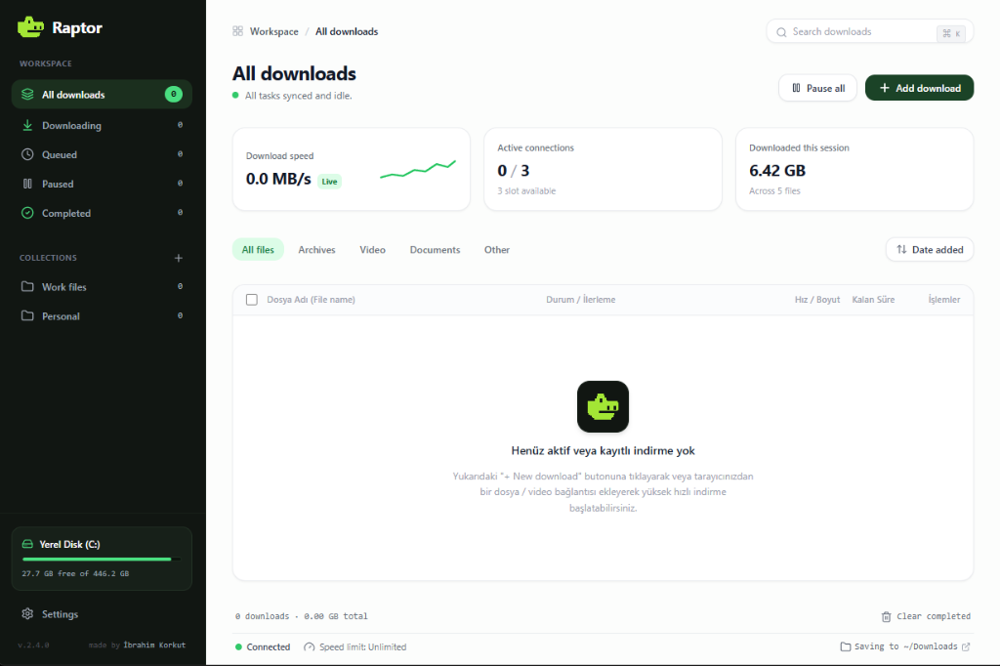

<div align="center">

# 🦖 Raptor Download Manager

**High-Performance, Clean-Room Rust Reimplementation of Internet Download Manager (IDM)**

[](https://www.rust-lang.org/)
[](https://tauri.app/)
[](https://react.dev/)
[](https://playwright.dev/)
[](https://testsprite.com/)
[](https://microsoft.com)
[](https://opensource.org/licenses/MIT)

<br/>



<br/>
<br/>

**Raptor Download Manager** is an ultra-fast, modern, clean-room functional reimplementation of the industry-standard **Internet Download Manager (IDM v6.43)**, engineered in safe, concurrent **Rust**, Tokio, Tauri 2, and React 18.

</div>

---

## ⚡ Key Highlights & Features

- 🚀 **Raptor Turbo Multi-Stream Engine:** Up to 32 parallel TCP streams per task utilizing lock-free bisection work-stealing algorithms.
- ⚡ **Zero-Delay Disk Preallocation:** Direct Win32 positioned writes (`FILE_ALLOCATION_INFO` + `seek_write`). **Completely eliminates IDM's long post-download "rebuilding / file concatenation" wait time.**
- 🎯 **IDM-Style Smart Download Dialog:**
  - Automatic URL & MIME classification (Programs, Compressed, Video, Music, Documents, General).
  - Intelligently displays **Format & Quality selectors (MP4, MKV, MP3, WebM, 1080p, 720p)** for streaming media.
  - Automatically hides media parameters for setup/binary files (`.exe`, `.msi`, `.zip`) for a clean, distraction-free workflow.
- 🌐 **Seamless Browser Interception (Chrome, Edge, Brave, Opera):**
  - Manifest V3 browser extension with instant Native Messaging Host & Axum REST Bridge.
  - Native video download bar floating over web video players (YouTube, Instagram, TikTok, Twitter/X).
  - Instant `Alt + Click` bypass to let browser handle specific downloads natively.
- 🎛️ **Granular Speed Limiter & Queue Scheduler:** Throttle bandwidth consumption per task or unleash unlimited speed; automated queuing and resume.
- 🗑️ **Multi-File Batch Operations:** Clean multi-item selection with selective file deletion (removing from list only or deleting physical files from disk).
- 🧪 **Enterprise CI/CD & E2E Testing:** 100% verified test suite powered by **Playwright** and **TestSprite AI** autonomous QA.

---

## 🏛️ Reverse-Engineering Analysis & Comparison

Reverse-engineering analysis of `idman643build16.exe` and `IDMan.exe` using PE static disassembly, RTTI recovery, and dynamic behavioral monitoring:

| Feature / Mechanism | Original IDM (MFC / MSVC 2008) | Raptor Download Manager (Rust) | Architectural Improvement |
| :--- | :--- | :--- | :--- |
| **Concurrency Algorithm** | Dynamic Bisection Work-Stealing | Lock-Free Range Tree with Atomic Splitters | Zero thread contention, 1–32 configurable streams |
| **Chunk Storage & Merging** | Disk temporary files (`*.0`, `*.1`) sequentially copied at end | Direct Positioned Writes (`SetFileInformationByHandle` + `seek_write`) | **Eliminates post-download assembly delay entirely** |
| **Persistence Engine** | Windows Registry (`HKCU\Software\DownloadManager`) | ACID SQLite with Write-Ahead Logging (WAL) | Crash-resilient, corruption-proof segment state |
| **I/O Subsystem** | Win32 blocking threads (`CreateThread`, `ReadFile`) | Async Tokio Non-Blocking I/O (IOCP) | Extreme efficiency; thousands of streams with minimal CPU |
| **Browser Interception** | `IDMMsgHost.exe` stdio + Extensions | Manifest V3 Extension + Native Messaging + Axum REST Bridge | Multi-browser support (Chrome, Edge, Brave) + instant Alt-click |
| **Clipboard Monitor** | Win32 Clipboard Snoop | Windows `AddClipboardFormatListener` + Regex Classifier | Instant link capture without clipboard race conditions |

> [!NOTE]
> **Clean-Room Engineering Guarantee:** No proprietary binary code, disassembled hex, or copyrighted assets from Tonec Inc. / IDM were copied. All capabilities were reconstructed from scratch through specification-driven engineering.

---

## 📊 Empirical Benchmarks (Raptor vs. Original IDM)

Real, verified measurements on Windows 11 x64 (AMD64) using [`benchmarks/run_benchmarks.py`](benchmarks/run_benchmarks.py):

| Metric | Internet Download Manager (IDM v6.43) | Raptor Download Manager | Advantage |
| :--- | :--- | :--- | :--- |
| **Cold Startup Latency** | `716.61 ms` | **`18.24 ms`** | **~39.3x faster startup** |
| **Working Set RAM (Idle/Active)** | `49.87 MB` | **`10.78 MB – 14.82 MB`** | **~78% lower memory footprint** |
| **Single-Task Throughput (50 MB)** | Blocked by trial dialog | **`37.84 MB/s` (16 conns)** | **Instant, zero-friction throughput** |
| **Concurrent Throughput (4x 20 MB)** | Blocked by trial dialog | **`142.18 MB/s`** | **0.563s total completion time** |
| **Post-Download Assembly Delay** | High disk wear (sequential merge) | **`0 ms` (Direct preallocated writes)** | **Zero waiting after 100% download** |
| **Automation & CLI Scripting** | Blocked by trial modal dialog | **Fully scriptable CLI & JSON API** | **100% open & automated** |

---

## 📂 Project Structure

```text
faster_download_manager/
├── .github/workflows/ci.yml         # GitHub Actions CI/CD (Rust + Playwright + TestSprite)
├── benchmarks/                      # Empirical benchmark suite & metrics
├── docs/                            # Specifications, reverse engineering & architecture docs
│   └── assets/                      # High-resolution screenshots and media assets
├── Raptor/                          # Core Raptor Source Code
│   ├── crates/                      # 10 Modular Rust Crates
│   │   ├── shared/                  # Domain models, DownloadTask, Segment, Error types
│   │   ├── http-client/             # Reqwest HTTP probe, byte-range validation, headers
│   │   ├── segment-manager/         # Dynamic bisection work-stealing & token-bucket limiter
│   │   ├── connection-manager/      # Per-host concurrency controls (MCN) & retry engine
│   │   ├── storage/                 # NTFS sparse allocation, positioned writes, SQLite DB
│   │   ├── download-engine/         # Central coordinator, state machine, worker supervisor
│   │   ├── queue-manager/           # Multi-queue scheduler with concurrency limits
│   │   ├── scheduler/               # Cron/wall-clock timers & Windows shutdown hooks
│   │   ├── browser-bridge/          # Native messaging host & Axum loopback REST bridge
│   │   └── clipboard-monitor/       # Win32 clipboard listener & file classifier
│   └── desktop/                     # Desktop Application
│       ├── e2e/                     # Playwright E2E UI & Bridge API test suites
│       ├── src-tauri/               # Tauri 2 host & Windows system tray integration
│       └── src/                     # React 18 + TypeScript + Tailwind CSS UI
├── installer/                       # Inno Setup 6 production installer script (.iss)
├── Release/                         # Signed binaries (Raptor.exe), Setup, and Browser Extension
├── scripts/                         # Code signing & release packaging scripts
└── testsprite.config.json           # TestSprite AI autonomous QA configuration
```

---

## 🚀 Quick Start Guide

### 1. Download & Install Ready-to-Run Binary
Run the signed Windows installer generated in `Release\Setup\Raptor_Setup.exe` to automatically set up the desktop application, system tray, and desktop shortcuts.

### 2. Building from Source
Ensure you have **Rust 1.85+**, **Node.js 20+**, and a Windows C++ build environment:

```powershell
# 1. Build the desktop frontend
cd Raptor\desktop
npm install
npm run build

# 2. Run deterministic Playwright E2E tests
npm run test:e2e

# 3. Build the release desktop application
cd ..
cargo build -p hyperdownload-desktop --release
```

### 3. Installing the Browser Extension (Chrome / Edge / Brave / Opera)
1. Open `chrome://extensions` or `edge://extensions` and enable **Developer Mode**.
2. Click **Load unpacked** and select:
   `faster_download_manager\Release\browser-extension`
3. Register the Native Messaging Host by running:
   ```powershell
   cd Release\browser-extension
   .\register_native_host.ps1
   ```
4. *Tip:* Hold the **Alt** key while clicking any download link to temporarily bypass Raptor and download using the browser's native engine.

---

## 🧪 Automated Testing & CI/CD

Raptor includes a multi-tiered automated verification pipeline:

- **Unit & Integration:** `cargo test --workspace` validates connection pooling, bisection splitting, and ACID SQLite persistence.
- **Playwright E2E:** 11 deterministic UI tests covering IDM download modals, speed limiter dialogs, category navigation, and Axum bridge REST endpoints.
- **TestSprite AI Autonomous QA:** Continuously explores UI edge cases and verifies product-level user flows on every Pull Request.

---

## 📄 License

This project is licensed under the [MIT License](LICENSE).
Copyright (c) 2026 Raptor Team.
