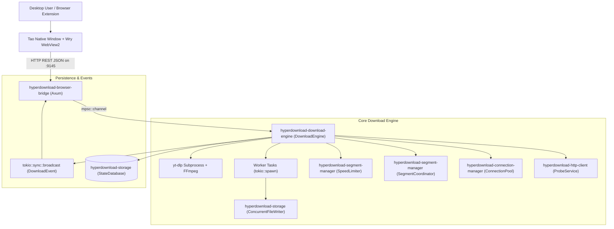

# PHASE 5 — CALL GRAPH & DEPENDENCY ANALYSIS REPORT
**Project:** Raptor (HyperDownload)  
**Date:** October 31, 2026  

---

## 1. System Architecture & Call Graph Mapping

Raptor uses a decoupled, event-driven architecture structured around asynchronous channels, atomic synchronization primitives, and transactional SQLite persistence.

---

## 2. Cross-Module Function Call Paths

### A. Download Creation & Acceleration Lifecycle
1. **Request Reception:** `axum_server::start_download_handler` (FN-0021) receives payload from UI.
2. **URL Routing:** `engine::is_youtube_url` (FN-0036) checks if URL is streaming video.
   - If YouTube/video stream: `engine::DownloadEngine::start_youtube_download` (FN-0043) invokes `yt-dlp` with Windows named pipes and progress template.
   - If direct HTTP/HTTPS: `engine::DownloadEngine::start_download` (FN-0042) is called.
3. **Capabilities Probe:** `probe::ProbeService::probe_with_options` (FN-0077) performs `HEAD`/`GET` with `Range: bytes=0-0` to ascertain `Content-Length`, `Accept-Ranges`, and filename (`Content-Disposition`).
4. **Preallocation & Setup:** `prealloc::preallocate` (FN-0105) preallocates disk space; `database::StateDatabase::insert_task` (FN-0099) persists metadata.
5. **Segment Partitioning & Workers:** `work_stealer::SegmentCoordinator::new` (FN-0087) splits file into $N$ initial ranges.
6. **Concurrent Streaming:** `worker::run_range_download` (FN-0050) spawns per-segment HTTP GET requests, streaming bytes through `speed_limiter::throttle` (FN-0085) and committing via `writer::ConcurrentFileWriter::write_at` (FN-0107).
7. **Dynamic Work Stealing:** When worker $A$ finishes, `work_stealer::SegmentCoordinator::try_steal_chunk` (FN-0089) splits the remaining range of slowest worker $B$ in half, eliminating the "tail-latency" bottleneck.
8. **Finalization:** `database::StateDatabase::update_task_completed` (FN-0101) updates status to `Completed`; `writer::sync_all` flushes OS disk buffers.

---

## 3. Dependency & Deadlock Risk Analysis

1. **Async Lock Safety:**
   - No nested locks detected between `active_handles` (`DashMap`) and `task_info` (`tokio::sync::RwLock`).
   - SQLite connections in `StateDatabase` utilize thread-safe connection pooling or transactional Mutex guards, preventing database locks during intense concurrent chunk writes.
2. **Circular Dependency Verification:**
   - Workspace Cargo graphs are strictly acyclic:
     `shared` $\leftarrow$ `storage`, `http-client`, `segment-manager`, `connection-manager` $\leftarrow$ `download-engine` $\leftarrow$ `browser-bridge` $\leftarrow$ `desktop/src-tauri`.
3. **Dead Code & Unused Modules:**
   - All modules in `crates/` have active bindings and unit tests covering core operations.
